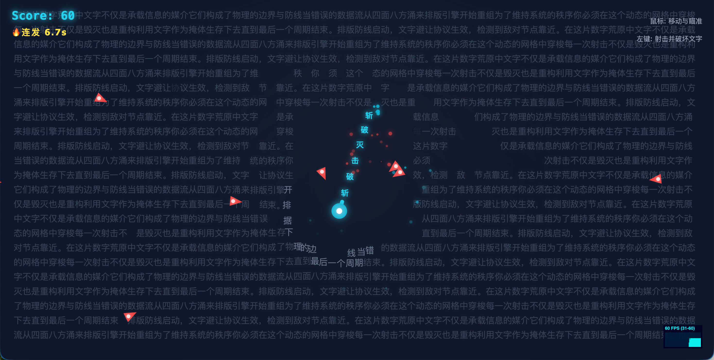

# Agent 编程防线 / Editorial Defender



一款以新时代 Agent 编程势力对抗守旧古法编程势力为主题的生存射击游戏。背景不是普通贴图，而是一组由新旧编程关键词构成、会“避让”玩家的文字岛；玩家需要驾驶代理核心在动态文字地形与主通道之间生存、射击并收集增益道具。

它不是传统意义上的“坦克打怪”原型，而是把 Agent 协作、关键词编排和文字避让这些技术语义，重新翻译成了可游玩的空间机制。

## 玩法概览

你需要在屏幕中央附近建立生存节奏：

- 操控代理核心在文字墙之间游走
- 利用文字的动态避让制造临时通道
- 射击古法编程势力并击碎局部文本障碍
- 抢在敌潮合围前收集增益道具，拉开生存窗口

随着时间推进，古法编程势力会越来越密集，场面会从可控的关键词冲突，逐渐演变成高压的代码战场。

## 特性

- 使用 `@chenglou/pretext` 进行关键词级文本预处理与宽度计算
- 通过 `pretext` 驱动文字岛整词布局，保证关键词不会被拆成半词换行
- 使用曲折主通道 + 贴边掩体岛链构建可读路径，让主路不再是空旷十字开口
- 文字岛会按分辨率自适应配平尺寸、间距与保底数量，避免低分辨率下地图过空
- 逻辑更新与渲染分离，便于继续做性能优化
- 集成 `stats.js` 实时观察渲染 FPS / 帧耗时
- 纯 TypeScript + DOM 分层渲染，便于直接调整玩法和视觉细节

## 操作方式

- 鼠标移动: 控制坦克朝目标位置平滑移动
- 鼠标左键按住: 持续开火
- `Esc`: 暂停 / 恢复当前战局
- 触摸开始 / 拖动: 在移动端控制坦克并持续攻击
- 目标: 尽可能长时间生存并提高分数

## 设计亮点

### 把“排版”做成地形

文字层不是静态背景，而是具备物理感的动态障碍。玩家靠近时，文字会被推开；离开后，文字又会缓慢回弹，形成一种介于 UI 与地形之间的独特空间反馈。

### 把“绕排”做成世界规则

项目没有直接手写整张文字地图，而是利用 `pretext` 在多个随机矩形簇中逐行布局，并生成一条可贯通的曲折主通道。这让场景结构既稳定又保留了真实排版感，同时让文字墙更像能借力周旋的战壕。

### 把“文本碎裂”做成战斗反馈

玩家子弹不仅能打敌人，也能击碎文字墙。战斗过程会不断把 Agent 与古法阵营的关键词切碎又重排，强化“代码话语权正在争夺”的主题体验。

## 技术栈

- Vite
- TypeScript
- `oxlint` + `oxlint-tsgolint`
- `@chenglou/pretext`
- `stats.js`
- 原生 CSS

## 运行方式

```bash
pnpm install
pnpm dev
```

生产构建：

```bash
pnpm build
```

代码检查与自动修复：

```bash
pnpm lint
```

VS Code / Cursor:

- 安装工作区推荐扩展 `oxc.oxc-vscode`
- 保存时会执行 `Oxc` 格式化和 `Oxlint` 自动修复
- `type-aware` linting 由项目级 Oxlint 配置统一开启

## 项目结构

- [src/main.ts](src/main.ts): 应用入口，负责启动游戏
- [src/game/index.ts](src/game/index.ts): 游戏编排层，负责主循环、事件绑定与整体状态推进
- [src/game/state.ts](src/game/state.ts): 全局运行时状态
- [src/game/entities.ts](src/game/entities.ts): 核心实体定义与局部更新逻辑
- [src/game/layout.ts](src/game/layout.ts): `pretext` 关键词布局、通道/岛链生成与文字分桶
- [src/game/rendering.ts](src/game/rendering.ts): DOM 对象池与渲染同步
- [src/game/dom.ts](src/game/dom.ts): DOM 引用收集、UI 显隐与调试面板初始化
- [src/game/constants.ts](src/game/constants.ts): 常量、语料、道具配置
- [src/game/types.ts](src/game/types.ts): 共享类型定义
- [src/game/utils.ts](src/game/utils.ts): 碰撞与数学工具
- [index.html](index.html): 舞台和 UI 的 DOM 结构与样式
- [AGENTS.md](AGENTS.md): 面向 AI agent 和开发者的项目约束与架构说明

## 核心机制

### 文本布局

背景文字不是手写坐标铺排，而是通过 `pretext` 驱动的关键词布局完成：

- `prepareWithSegments()` 逐个预处理关键词
- 每个关键词先由 `pretext` 计算宽度，再按整词装入文字岛
- 先生成“曲折主通道 + 中央战斗室”，再把文字限制在随机簇状岛链中
- 文字岛的尺寸、内边距、行距和保底补位会随分辨率调整，低分辨率下仍能维持稳定岛链密度
- 留白区域会生成轻量漂浮字粒，补足氛围但不参与碰撞，并主动避开主通道

这让文字层既保留了真实排版感，也避免在高分辨率下把文本节点数直接堆到整张屏幕上。

### 游戏循环

- `update()` 以固定 60 FPS 执行，负责移动、碰撞、刷怪、buff 与生命周期
- `renderLoop()` 使用 `requestAnimationFrame()`，负责把状态同步到 DOM
- `stats.js` 挂在 `renderLoop()` 外围，显示实时 FPS 和渲染耗时
- 全部持续时间逻辑都依赖 `frameCount`
- `Esc` 会把游戏切到暂停态，此时逻辑推进和 `frameCount` 都会冻结，但当前画面会继续渲染并显示暂停蒙层

为了降低入口复杂度，当前代码已经按职责拆分为“编排层 / 状态层 / 实体层 / 布局层 / 渲染层 / DOM 层 / 工具层”。这让继续扩展敌人、布局算法或渲染优化时，不需要再在一个超长 `main.ts` 里来回穿梭。

### 当前实体

- `Tank`: 玩家坦克
- `TextBlock`: 可被击碎并会重生的文字墙单元
- `Bullet`: 敌我子弹
- `Enemy`: 从边缘刷新的古法编程敌军
- `PowerUp`: 冻结、连发、无敌、环射四类增益
- `Particle`: 爆炸和命中特效

### 增益道具

- `freeze`: 暂停敌人的移动与射击节奏
- `rapid`: 显著缩短玩家开火间隔
- `invincible`: 玩家免疫伤害，并可直接撞毁敌人
- `barrage`: 玩家每次开火都会向 360 度同时发射一圈子弹

## 最近的性能优化

本次已完成的优化包括：

- `pretext` 关键词级测宽，保证文字岛整词完整性
- 字形宽度缓存，减少 `canvas.measureText()` 调用
- 文字空间分桶，降低“子弹撞文字”的扫描成本
- `TextBlock` 脏更新渲染，减少无效 DOM 样式写入
- buff 文案仅在内容变化时才更新
- 多处圆形碰撞改为平方距离比较，减少开方开销
- 文字布局从整屏文字墙切换为“随机文字岛链 + 曲折主通道 + 留白粒子”，给高分辨率场景增加文字总量预算上限

这些优化的目标不是单纯“跑得更快”，而是保证当文字、粒子、子弹和敌人同时变多时，游戏仍然维持稳定、清晰的操作反馈。

## 调试工具

- 右下角已接入 `stats.js` 调试面板
- 默认显示 `FPS`，点击面板可切换到 `MS`，在支持的环境下也可查看内存面板
- 该面板基于 `requestAnimationFrame()` 采样，反映的是实际渲染帧率而不是逻辑更新频率

## 后续可以继续优化的方向

- 为敌人与玩家子弹碰撞也加入空间分桶
- 为子弹、敌人、粒子层加入更细的脏更新
- 把更新循环统一为 `requestAnimationFrame + fixed timestep`
- 在移动端进一步降低粒子和阴影特效开销

## 适合继续扩展的方向

- 新增不同形状的安全区，做出更强的“多栏排版”视觉
- 增加 Boss 或特殊敌人，让它们具备改写文本地形的能力
- 引入主题语料包，让不同关卡拥有不同语言与排版气质
- 把当前生存模式扩展成关卡制或限时挑战模式

## 开发说明

- 游戏状态重置入口在 [src/game/index.ts](src/game/index.ts) 的 `startGame()`
- 窗口变化时会走 [src/game/index.ts](src/game/index.ts) 的 `resizeStage()` 重新生成文字布局
- 文本地形和空间分桶逻辑集中在 [src/game/layout.ts](src/game/layout.ts)
- 动态实体 DOM 池与渲染同步集中在 [src/game/rendering.ts](src/game/rendering.ts)
- 如果你修改了主循环、渲染模型或性能策略，请同步更新 [AGENTS.md](AGENTS.md)
